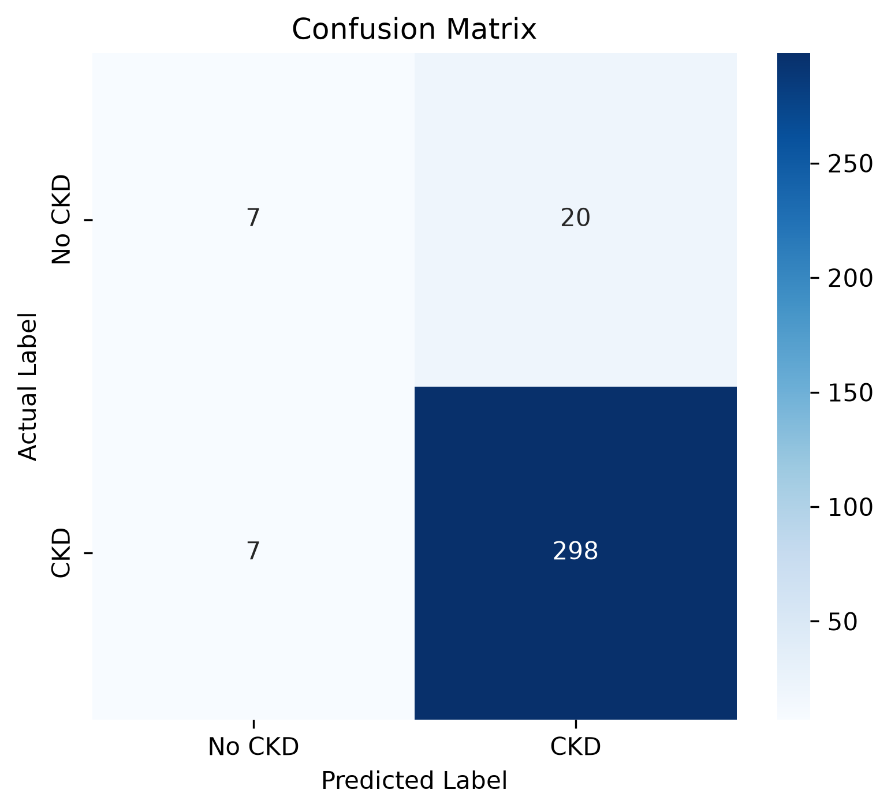
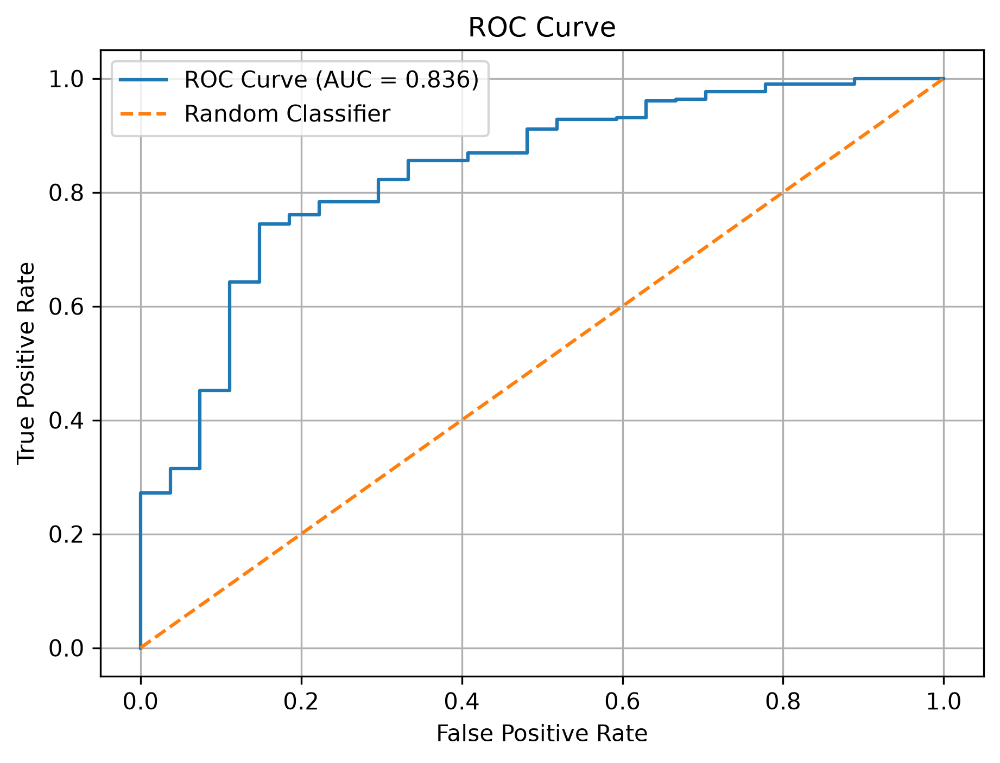
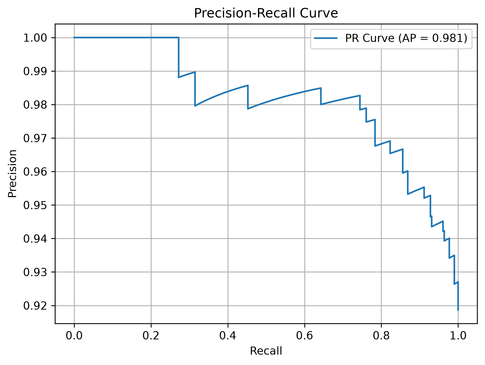

# 🏥 AI101-MiniProject-CKD-Logistic-Regression (Group-26)
> **Predicting Chronic Kidney Disease (CKD)** using advanced Logistic Regression modeling.  
> *An AI101 Mini-Project | IIT Ropar*

---

## 👥 Team Members & Roles

| Team Member | GitHub | Role | Core Responsibility |
| :--- | :--- | :--- | :--- |
| **SUDA TANISHQ REDDY** | [@STanishqReddy](https://github.com) | 📝 Documentation Lead | Dataset exploration, README architecture, & notebook integration |
| **ABHISHEK** | [@WebDevbyAbhi](https://github.com) | ⚙️ Execution Lead | Conda environment setup, dependency management, & preprocessing |
| **PRABHNOOR KATARIA** | [@prabhnoor-wml](https://github.com) | 📊 PPT Lead | Logistic Regression model architecture, training, & deck preparation |
| **DAVULURI VINOD** | [@Vinod-Davuluri](https://github.com) | 🎬 Video Lead | Model evaluation (ROC/PR curves), metrics analysis, & video demo |

---

## 📂 Project Structure

```text
AI101-MiniProject-CKD-Logistic-Regression/
├── 📁 docs/                         # Project blueprint & documentation
│   ├── problem_statement.md
│   ├── demo_plan.md
│   └── model_evaluation_plan.md
├── 📁 presentation/                 # Slide decks & presentation materials
│   └── CKD_Project_Presentation.pptx
├── 📁 results/                      # Performance visualization exports
│   ├── precision_recall_curve.png
│   └── roc_curve.png
├── 📁 video/                        # Final video demonstration output
├── 📊 Chronic_Kidney_Disease_data.csv
├── 📓 CKD_Logistic_Regression.ipynb
├── 📦 environment.yml
├── 📋 requirements.txt
└── 📝 README.md
```

---

## 🏆 Team Contributions

> Detailed operational breakdown of specific milestones achieved by each member during the lifecycle of the project.

* **📝 Documentation Lead**
  * Explored and mapped raw dataset structural traits.
  * Authored clean, readable repository documentation.
  * Formatted and integrated individual notebook sections.
* **⚙️ Execution Lead**
  * Built and verified the stable Conda pipeline environment.
  * Tracked, pinned, and managed package dependencies.
  * Configured data imputation and pipeline preprocessing.
* **📊 PPT Lead**
  * Engineered the production-ready Logistic Regression model.
  * Computed data predictions and hyperparameter balances.
  * Structured the conceptual logic for the mid-review deck.
* **🎬 Video Lead**
  * Extracted precision-recall tables and classification metrics.
  * Exported performance plots (ROC curve / Confusion Matrix).
  * Edited and recorded the final 5-minute project showcase video.

  ## ⚙️ Setup and Installation

### Python Version

This project uses **Python 3.13.16**.

### Requirements

All the required Python libraries are listed in the `requirements.txt` file.

The main libraries used in this project are:

- **Pandas** – Data loading and manipulation
- **NumPy** – Numerical operations
- **Matplotlib** – Data visualization
- **Seaborn** – Statistical data visualization
- **Scikit-learn** – Data preprocessing and Logistic Regression model
- **Jupyter Notebook** – Running the project notebook

### Prerequisites

Before running the project, make sure you have installed:

- [Miniconda](https://www.anaconda.com/docs/getting-started/miniconda/install)
- Git

## ▶️ Steps to Run the Project

Follow these commands in the given order.

**Step 1: Clone the GitHub repository**

```bash
git clone https://github.com/STanishqReddy/AI101-MiniProject-CKD-Logistic-Regression.git
```

**Step 2: Navigate to the project directory**

```bash
cd AI101-MiniProject-CKD-Logistic-Regression
```

**Step 3: Create a Conda environment with Python 3.13.16**

```bash
conda create -n ckd-ai101 python=3.13.16
```

**Step 4: Activate the environment**

```bash
conda activate ckd-ai101
```

**Step 5: Install all required dependencies**

```bash
pip install -r requirements.txt
```

**Step 6: Launch Jupyter Notebook**

```bash
jupyter notebook
```

**Step 7: Open and run the project**

1. Open `CKD_Logistic_Regression.ipynb` in Jupyter Notebook.
2. Make sure `Chronic_Kidney_Disease_data.csv` is present in the project directory.
3. Select **Kernel → Restart Kernel and Run All Cells**.
4. Wait for all cells to execute successfully and view the model results and evaluation graphs.

### ✅ Expected Result

After successfully executing the notebook, you should be able to see:

- Dataset exploration and preprocessing results.
- Logistic Regression model training and predictions.
- Model evaluation metrics such as Accuracy, Precision, Recall and F1-score.
- Confusion Matrix and Classification Report.
- ROC Curve and Precision-Recall Curve.

**Note:** Run the notebook from the project directory so that the dataset's relative file path works correctly.

### ✅ Evaluation Visualizations

The following graphs are saved in the results/ directory:

- #### 📈 Confusion Matrix

  

  #### Model Evaluation: Confusion Matrix Insights

The confusion matrix visually demonstrates how well our machine learning model distinguishes between patients with Chronic Kidney Disease (**CKD**) and healthy individuals (**No CKD**). 

##### 📊 Matrix Breakdown
* **True Positives (TP) = 298:** The model correctly identified 298 individuals who actually have Chronic Kidney Disease.
* **True Negatives (TN) = 7:** The model correctly identified 7 individuals who do not have Chronic Kidney Disease.
* **False Positives (FP) = 20:** The model incorrectly flagged 20 healthy individuals as having Chronic Kidney Disease.
* **False Negatives (FN) = 7:** The model missed 7 patients who actually have Chronic Kidney Disease, incorrectly predicting them as healthy.

##### 📈 Key Performance Indicators
* **Overall Accuracy (~91.87%):** Out of 332 total patients in the test set, the model made the correct prediction nearly 92% of the time.
* **High Sensitivity / Recall (~97.70%):** The model successfully captured the vast majority of positive CKD cases. In medical diagnostics, a high recall rate is critical because it ensures that very few sick patients go unnoticed.
* **Balanced Precision (~93.71%):** When the model predicts a patient has CKD, it is highly reliable, with low rates of false alarms.

##### 🔍 Project Observation
While the overall accuracy and recall are highly promising for medical screening, the dataset appears to be heavily imbalanced toward positive CKD cases (305 CKD vs. 27 No CKD). Future work could explore balancing techniques like SMOTE or gathering more control samples to further enhance the model's ability to accurately predict healthy cases.

- #### 📈 ROC Curve

  

#### Model Evaluation: ROC Curve Analysis

To assess the performance of our **Chronic Kidney Disease (CKD)** prediction model, we plotted the **Receiver Operating Characteristic (ROC)** curve and calculated the **Area Under the Curve (AUC)** shown above. 

##### Key Insights & Performance Interpretation:

* **Discriminative Power ($\text{AUC} = 0.836$):** The model achieves an AUC of **0.836**, indicating **good overall classification performance**. This means there is an **83.6% probability** that the model will correctly assign a higher disease risk score to a randomly selected CKD patient than to a healthy individual.
* **Comparison Against Baseline:** The blue step-curve sits substantially above the red dashed diagonal line ($\text{AUC} = 0.50$), confirming that the model performs significantly better than random guessing and has successfully captured relevant predictive patterns from the Kaggle dataset.
* **Step-Like Behavior:** The jagged, stair-step appearance of the curve is a characteristic visual artifact caused by a discrete, finite sample size in our test evaluation set as the classification threshold shifts.

##### Clinical Implementation & Threshold Tuning:
Depending on the clinical deployment goals, we can use this curve to fine-tune our classification threshold:
* **Screening Mode (High Sensitivity):** We can move along the curve to maximize the **True Positive Rate** to ensure early stages of CKD are rarely missed, minimizing dangerous False Negatives.
* **Diagnostic Mode (High Specificity):** Alternatively, we can adjust the threshold to minimize **False Positives**, protecting healthy patients from unnecessary anxiety and costly follow-up medical testing.


- #### 📈 Precision Recall Curve

  

  #### Model Evaluation: Precision-Recall (PR) Curve Analysis

To complement our ROC analysis, we evaluated the model using a **Precision-Recall (PR) Curve** and calculated the **Average Precision (AP)** score. While ROC curves can sometimes provide an overly optimistic view on imbalanced datasets, the PR curve focuses directly on the prediction quality of the positive class (patients with Chronic Kidney Disease).

##### Key Insights & Performance Interpretation:

* **Exceptional Precision Quality ($\text{AP} = 0.981$):** The model achieves an outstanding Average Precision of **0.981**. This means that across all operational thresholds, the model maintains an extremely high ratio of true positive predictions compared to total positive predictions, minimizing false alarms.
* **Zoomed-In Precision Axis:** Note that the precision axis is focused heavily on the high-end spectrum (**0.92 to 1.00**). Even as the model's capacity to find all sick patients increases (moving along the Recall axis from 0.0 to 1.0), the precision remains remarkably stable and drops no lower than roughly 0.92.
* **Data Imbalance Robustness:** In medical diagnostics, datasets are frequently imbalanced (fewer positive disease cases than healthy ones). An AP score of nearly 0.98 confirms that our model's high performance is robust and highly dependable, avoiding the pitfalls of false positives that could lead to clinical over-diagnosis.

##### Clinical Implementation & Threshold Tuning:
The PR curve explicitly shows how aggressively we can catch disease cases without overwhelming doctors with false alarms:
* **High Recall (Comprehensive Screening):** We can push the model to a Recall of 1.0 (catching 100% of the CKD patients in the dataset) while still maintaining a Precision of approximately 0.92. This ensures maximum patient coverage with minimal false positives.
* **High Precision (Definitive Diagnosis):** By selecting thresholds at the top of the curve, we achieve a Precision of 1.00. Any patient flagged at this setting is guaranteed to have CKD, making it ideal for automating high-confidence clinical alerts.
*
These visualizations help understand the classification performance of the trained model.

### 📊 Project Presentation

Our project presentation contains the problem statement, dataset overview, methodology, model results, team contributions and key learnings.

 Presentation: https://gamma.app/docs/Chronic-Kidney-Disease-prediction-using-Logistic-Regression-gokp4hfrabke7q6

### 🎬 Project Demonstration Video

The demonstration video explains the project workflow, model execution, evaluation results and team contributions.

 Video: [Add accessible video link here]

### 🤖 AI Tools Usage and Disclosure
AI tools were used as supporting resources during the development of this project.

Purpose of AI usage:

- Understanding Python programming and machine learning concepts.
- Getting explanations of pandas and scikit-learn functions.
- Assistance with debugging and improving code.
- Organizing project documentation and presentation content.

#### ⚠️ Verification:

The team reviewed and tested the code and project outputs. Each team member is responsible for understanding their contributions and the overall project workflow.

AI tools were used to support learning and development, not to replace the team's understanding and implementation.
